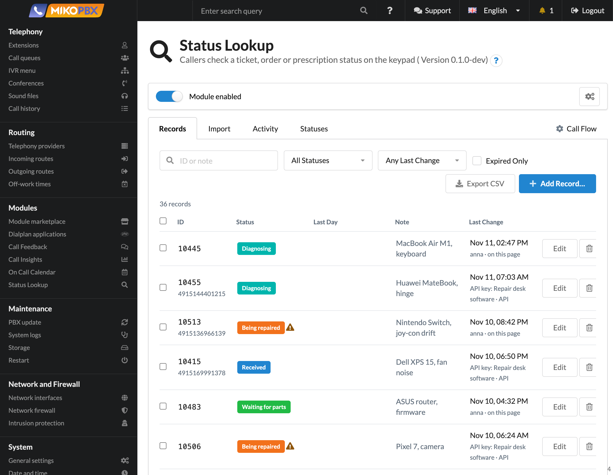
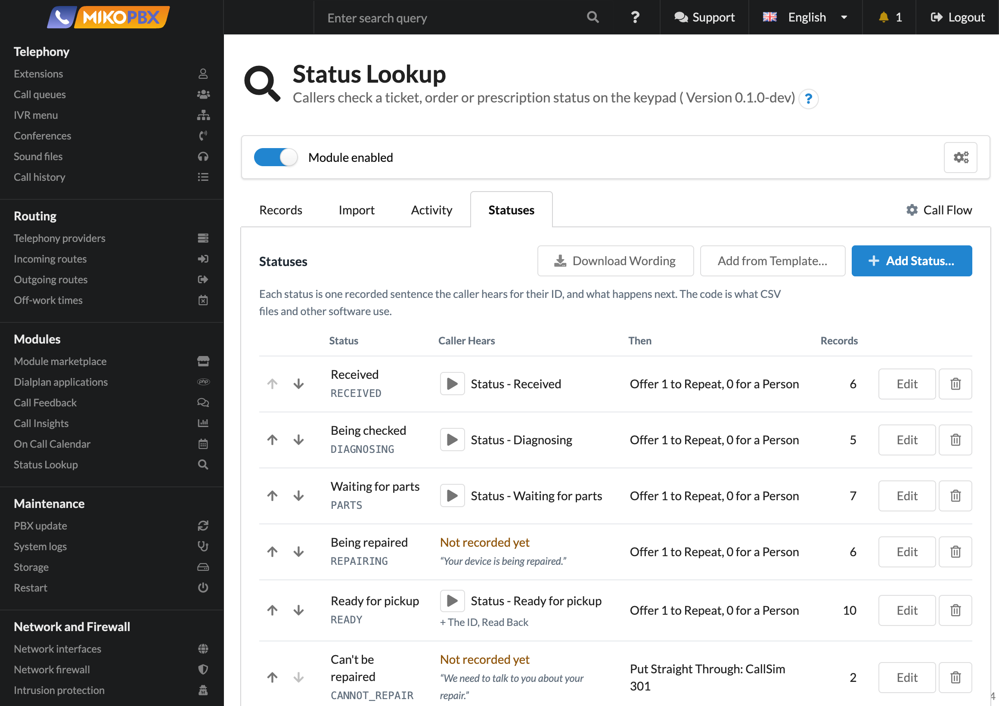
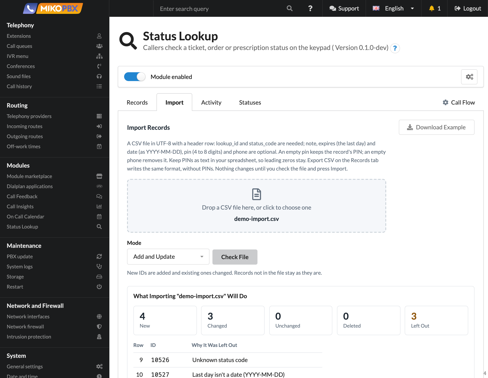
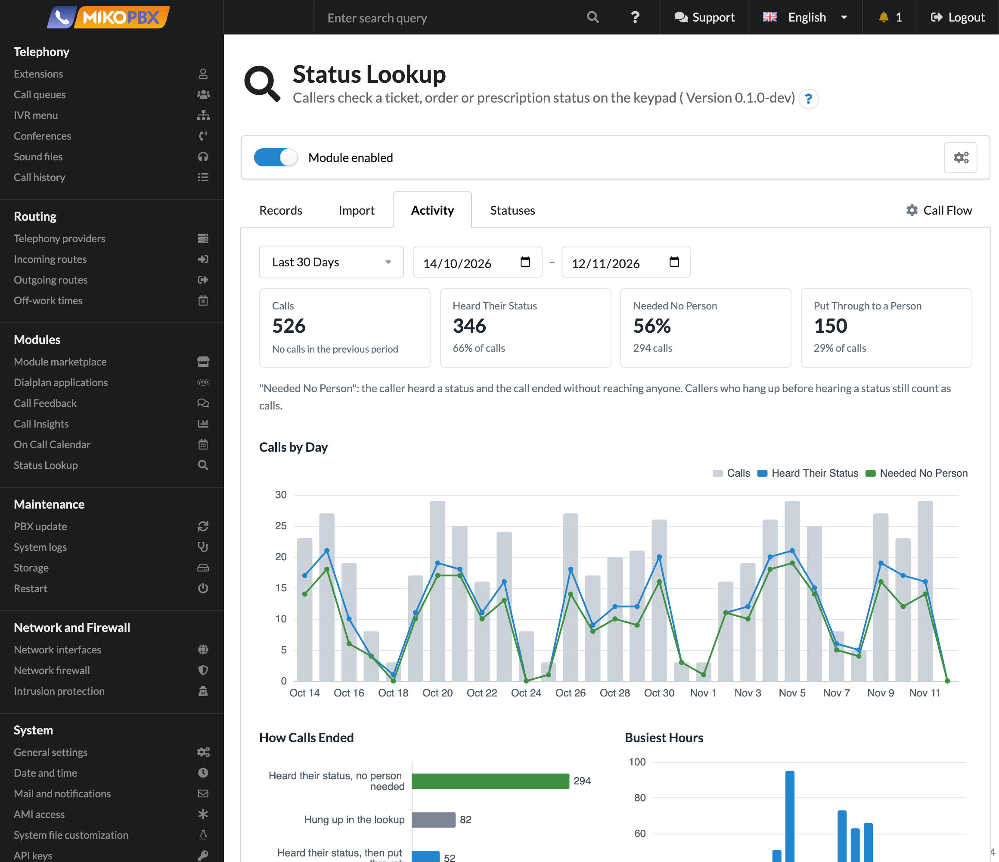
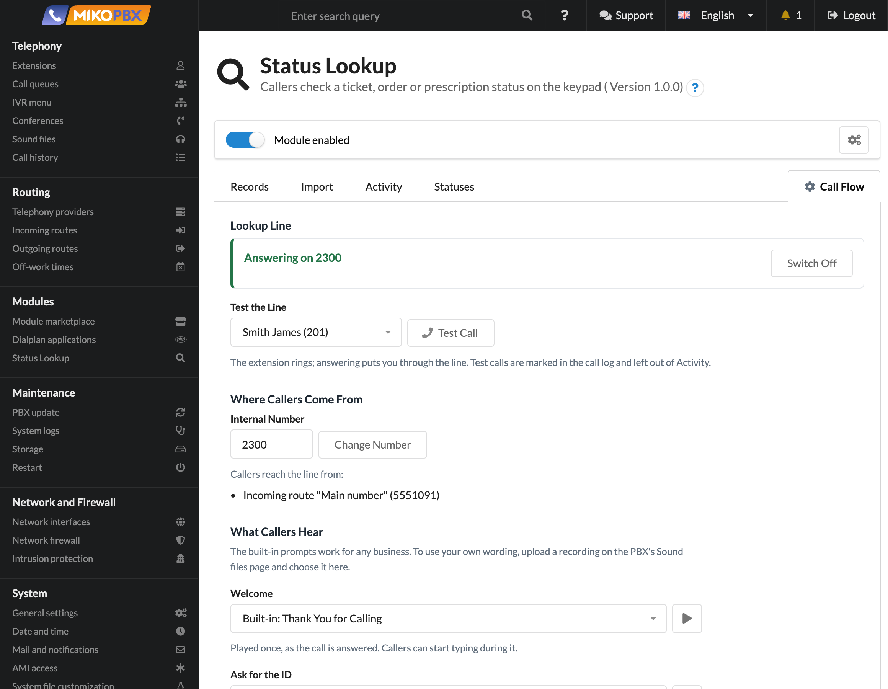

# Status Lookup for MikoPBX

**Module ID:** `ModuleStatusLookup`

A MikoPBX extension module that answers "Is it ready yet?" calls without a person. The caller types their ticket, order or prescription number on the keypad and hears its status from a recording: "Your device is ready for pickup." Statuses live in the module's own database on the PBX: loaded from a CSV file, edited by hand, or pushed by shop software over the REST API. No cloud service, CRM or internet connection is involved, and pressing 0 always reaches a person.

It suits any business whose customers call to ask where something stands: device and IT repair, auto workshops, pharmacies, shops and online stores.

> **Status: in development.** Not released yet. What has changed so far is in [CHANGELOG.md](CHANGELOG.md). The built-in prompts aren't recorded yet: until they are, choose one of your own sound files for every prompt on the Call Flow tab before switching the line on.



## Screenshots

The screenshots show a test PBX with simulated calls; the IDs, notes and numbers are made up.

<table>
  <tr>
    <td width="50%" valign="top">
      <a href="docs/screenshots/statuses.png"></a>
      <br><b>Statuses.</b> The statuses a record can have, each with its recorded sentence and what happens after it.
    </td>
    <td width="50%" valign="top">
      <a href="docs/screenshots/import.png"></a>
      <br><b>Import.</b> A CSV file is checked first: what is new, what changes, and every row left out, with its reason.
    </td>
  </tr>
  <tr>
    <td width="50%" valign="top">
      <a href="docs/screenshots/activity.png"></a>
      <br><b>Activity.</b> How many calls the line answered on its own, how calls ended, the busiest hours and the IDs callers couldn't find.
    </td>
    <td width="50%" valign="top">
      <a href="docs/screenshots/call-flow.png"></a>
      <br><b>Call Flow.</b> The line's number, what callers hear, how they type, where they go, and privacy settings.
    </td>
  </tr>
</table>

## Requirements

- MikoPBX 2026.6.34 or later.

## Installing

1. Download `ModuleStatusLookup-<version>.zip` and its `.sha256` file from this repository's **Releases** page. Use that zip: the "Source code" downloads GitHub adds to each release are for developers and can't be installed.
2. Check the download against its checksum, for example with `shasum -a 256 -c ModuleStatusLookup-<version>.zip.sha256` (macOS or Linux).
3. In the MikoPBX admin cabinet, open **Modules**, upload the zip, then enable the module.

Status Lookup appears in the sidebar for administrators. It takes internal number 2300 (or the first free number up to 2399) for its line. No call changes until the line is switched on and something sends callers to its number.

## Setting it up

1. **Statuses.** Open **Modules → Status Lookup**. The first time, the Statuses tab asks what kind of business this is and adds that business's usual statuses (or start from scratch). Each status needs one recorded sentence: upload the recordings on the PBX's **Sound files** page and choose each one with **Edit**. **Download Wording** lists what to record.
2. **Records.** Add records on the Records tab, or import a CSV file on the Import tab.
3. **Call Flow.** Choose the operator (where 0 and every dead end lead), check the prompts and the ID lengths, and **Switch On** the line.
4. **Test.** **Test Call** rings your extension and puts you through the line as a caller hears it.
5. **Send callers to it.** Point an incoming route, an IVR menu option or an off-work time rule at **Module: Status Lookup (2300)**, as you would a queue. Staff can also dial the number or transfer callers to it.

## How a call goes

1. The caller hears a welcome and is asked for their number (the ID). They type it and press #; they can start typing during the prompt.
2. The line looks the ID up and plays its status: one recorded sentence, optionally followed by the ID read back or the record's date ("Thursday, November twelfth").
3. After the status, the line says goodbye, offers "press 1 to hear it again, 0 to speak to someone" (up to three repeats), or puts the caller straight through to the status's own destination (for a status that needs a conversation).

Along the way:

- **0 reaches a person** at any prompt that listens for keys.
- **Three tries:** an ID that isn't found, an expired record or an entry that's too short or too long costs a try; after the last one, the caller goes to the too-many-tries destination.
- **Never a dead end:** a status that can't be played, a destination that has been deleted, or any fault sends the caller to the fault destination (the operator by default), with an apology.
- **Only the status is spoken,** never names or notes.
- **IDs are digits,** kept as text, so leading zeros count: `00451` and `451` are different records.
- Until the line is switched on, it doesn't answer, so an incoming route moves on to its next rule as for any unanswered destination.

The line behaves like the PBX's own IVR menus: it has its own row in the call history, tells the incoming route the call was answered, and takes transfers from phones. Its part of the call isn't recorded, because callers type IDs and PINs there.

## Using it

**Records** (the first tab): every record, newest change first, with search by ID or note, filters by status, by "not changed in 7, 30 or 90 days" and expired only, and changes to many records at once. **Export CSV** downloads the filtered records in the import format. Each record can have a **date** (spoken if its status says so), a **last day** (after it, callers hear "not found": a stale status is worse than none), a **note** for staff, a **phone number** and a **PIN**.

**Import:** a CSV file in UTF-8 with a header row; `lookup_id` and `status_code` are needed, `note`, `expires`, `date`, `pin` and `phone` optional. **Add and Update** adds new IDs and changes existing ones; **Replace All** also deletes records that aren't in the file (but never one whose row was left out for a mistake). **Check File** shows what would happen first; nothing changes until you press Import. A file of up to 5 MB and 100,000 rows is applied in one go, while calls keep being answered.

**Statuses:** the statuses a record can have, in the order staff see them. **Add from Template…** adds a business's statuses you don't have yet.

**Activity:** for any period up to a year: calls, how many heard their status, the share that needed no person, where the others went, calls by day, the busiest hours, the IDs callers typed most that weren't found (each with **Find in Records**), and the call log. Test calls are marked and left out of the numbers.

**Call Flow:** the line's state and test call; its number and what sends callers to it; the prompts (built-in English and Russian ones, or your own sound files); how callers type; where they go; the guessing protection; and privacy.

## Privacy and protection

- **PIN:** a status can ask for the record's PIN (4 to 8 digits) before it is told; the pharmacy template does. PINs are stored only as keyed hashes and can't be shown or exported.
- **Own phone only:** a status can be told only to a caller calling from the number saved on the record.
- **Guessing protection:** IDs that aren't found, wrong PINs and calls from other numbers all sound the same ("not found") and count as misses. Once a caller number has 10 misses in an hour, or all callers together have 200 (both by default; you can change them), the next ID they type goes straight to the operator instead of being looked up. After 10 wrong PINs for one ID in a day, from any callers, test calls included, that ID's PIN is no longer asked for: callers with that ID are put through to the operator instead.
- **Call log:** callers' numbers and the IDs they typed are kept for as long as the PBX keeps its call history (forever, if the PBX's setting is under 30 days), or for the number of days you set; older calls are deleted every night. Expired records can be deleted every night too. **Forget Someone's Data** deletes one ID's record, the logged calls for it and its wrong-PIN counts, or every logged call from one caller number and that number on records.
- MikoPBX's own Asterisk log records every key pressed on any call, IDs and PINs included; that is a PBX-wide setting outside the module.

See [SECURITY.md](SECURITY.md) for what the module exposes and how to report a problem.

## REST API

Shop, POS or ticketing software can keep the records up to date through the PBX's REST API (v3). The base path is `/pbxcore/api/v3/module-status-lookup/`.

| Method | Path | What it does |
| --- | --- | --- |
| GET | `records?search=&status=&expired=1&page=` | Lists records, newest change first, 50 a page. `search` is the start of an ID, or text in the note. |
| GET | `records/{lookup_id}` | One record; 404 when there is none. |
| PUT | `records/{lookup_id}` | Creates the record (201) or changes it (200). Fields left out keep their value; an empty string clears one (except `pin`, which only `remove_pin` clears). |
| DELETE | `records/{lookup_id}` | Deletes one record; 404 when there is none. |
| POST | `records:import` | Imports a CSV file (add and update): `{"csv": "...", "dryRun": true}`. With `dryRun`, nothing changes and the answer says what would. |
| POST | `records-replace:import` | The same, but the file becomes the full list: records not in it are deleted. |
| GET | `statuses` | The status codes records can have. |
| GET | `stats?from=YYYY-MM-DD&to=YYYY-MM-DD` | The Activity tab's totals for a period of up to 366 days, in PBX time. |

A record ID is the digits callers type, and leading zeros count. The fields PUT accepts are `status_code` (needed for a new record), `note` (for staff, never spoken), `status_date` and `expires_on` (YYYY-MM-DD), `phone`, `pin` (4 to 8 digits; only ever written, never shown) and `remove_pin` (true). Anything else is refused, so a misspelled field never goes unnoticed. The CSV format is the Import tab's; the CSV travels inside the JSON body, which the PBX limits to 4 MB.

```bash
curl -X PUT "https://pbx.example.com/pbxcore/api/v3/module-status-lookup/records/10445" \
  -H "Authorization: Bearer $API_KEY" -H "Content-Type: application/json" \
  -d '{"status_code": "READY", "expires_on": "2026-12-31"}'
```

**Access.** Create an API key on the PBX's API keys page and allow it the paths it needs, for example `/api/v3/module-status-lookup/records` with write access. Replacing all records is a path of its own (`/api/v3/module-status-lookup/records-replace`), so a key that updates records can't delete them all unless it is given that too. A key without the right access is refused with 401. Administrators' logins work as well, and, as everywhere in the PBX's REST API, scripts running on the PBX itself (localhost) need no key. A record changed through the API shows "API" and the key's description as who changed it.

A refusal answers 400 with an error code in `data.error` and its details in `data.params`:

- records: `lookup_id` (the ID isn't within the call flow's lengths), `record_status` (unknown status code), `status_required`, `unknown_fields`, `field_type` (a field that isn't text, or a `dryRun` that isn't true or false), `pin`, `phone`, `note`, `note_http`, `date`, `bad_request` (an unknown `status` filter);
- imports: `file_empty`, `file_size`, `file_encoding`, `file_header`, `file_rows`, `replace_empty` (Replace All with no usable row), `statuses_changed` (a status was renamed or deleted during the import; send it again);
- stats: `range_dates`, `range_long`.

A login whose role isn't administrator gets 403 (`forbidden`); an ID of more than 20 digits in the path gets 404.

The PBX's REST layer treats any text value starting with "http" as a web address and removes its spaces and non-Latin letters before the module sees it, so a note starting with "http" is refused rather than stored damaged; put a word before the link.

## Who can use it

Administrators only. The page and every action refuse anyone else, and the REST API accepts administrators' logins, API keys given its paths, and scripts on the PBX itself.

## Disabling and uninstalling

Disabling switches the line off and hides its number from the destination lists; calls sent to the number aren't answered meanwhile, so point routes elsewhere before disabling it for more than a moment. Enabling brings everything back as it was.

Uninstalling with **keep settings** keeps the records, statuses, settings, call log and PIN key for a later reinstall. Without it, all of those are deleted and the number is released in MikoPBX. A number that something still points at (an incoming route, an IVR menu option or an off-work time rule) can't be released and stays registered, so change those first; a later install takes it back, and those routes work again.

## Development

See [CONTRIBUTING.md](CONTRIBUTING.md) for the setup, the checks, how a call runs and how a release is made.

## License

GPL-3.0-or-later. See [LICENSE](LICENSE).
